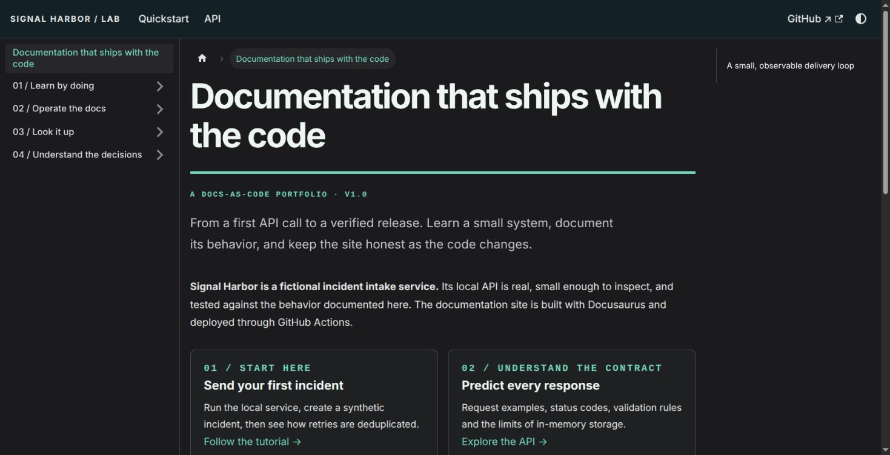

# Docs as Code Lab — Signal Harbor

A new **AI-assisted portfolio project** demonstrating Docusaurus documentation,
a runnable developer tutorial, API contract tests and a GitHub Actions deployment
pipeline. Created October 2026. Signal Harbor is fictional; all API data is synthetic.

- **Site:** https://abwonder.github.io/docs-as-code-lab/
- **Source:** https://github.com/Abwonder/docs-as-code-lab
- **Build/deployment evidence:** [GitHub Actions](https://github.com/Abwonder/docs-as-code-lab/actions)



The first [build and deployment](https://github.com/Abwonder/docs-as-code-lab/actions/runs/39036792928)
passed, and the live homepage and nested API page were checked in a browser.

## What was built

The site documents a small Node.js incident intake API. A reader can run it locally,
submit a synthetic incident, repeat a request safely and inspect exact failure
responses. The documentation is organized by reader need:

| Content | Reader outcome |
| --- | --- |
| Tutorial | Start the API and create/replay an incident |
| How-to guides | Develop docs, deploy, diagnose failures and practise recovery |
| API reference | Look up fields, validation, status codes and retry semantics |
| Explanations | Understand architectural decisions, security boundaries and project provenance |

There are 11 authored documentation pages, a responsive light/dark theme, explicit
sidebar navigation, source-edit links, fenced code examples and strict internal
link validation. GitHub Pages serves static documentation only; the demo API runs
on the reader's laptop and is not a public backend.

## Run it locally

Prerequisites: Git, Node.js 24, npm and curl. With nvm installed:

```bash
git clone https://github.com/Abwonder/docs-as-code-lab.git
cd docs-as-code-lab
nvm use
npm ci
npm run verify
npm start
```

Open the printed development URL under `/docs-as-code-lab/`. To preview exactly
what will deploy, run `npm run build`, then `npm run serve`.

In another terminal, start the synthetic API:

```bash
npm run demo
```

Follow the [first incident tutorial](docs/tutorials/first-incident.md). The API
binds to loopback on port 3333, requires no credentials and loses its in-memory
records when stopped. Never expose it publicly or use real incident data.

## How it was implemented

1. Checked the official Docusaurus installation and GitHub Pages deployment docs
   and the npm package metadata. Reused installed Node 24; dependencies are local
   to this repository rather than globally installed.
2. Configured Docusaurus 3.10.2 with the classic preset and React, documentation at
   the root route, a project-specific `baseUrl`, explicit sidebars and trailing
   directory routes for static hosting. The npm lockfile records resolved versions.
3. Wrote original synthetic documentation rather than copying an employer's docs.
   Added a small incident service so tutorial commands and reference behavior can
   be verified against an implementation.
4. Added Node's built-in HTTP and test modules: no server framework is needed.
   The example validates content type, key syntax, body size, title and severity.
   Matching retries preserve the incident ID; conflicting retries return 409.
5. Added a generated-output checker that walks built HTML, resolves internal link
   and asset URLs and verifies their targets under the GitHub project path.
   Docusaurus itself fails builds on broken internal Markdown links.
6. Added separate pull-request validation and main-branch deployment workflows.
   Tests and builds use read-only repository permissions. Only the deploy job
   requests Pages write access and an ephemeral identity token. No deploy secret,
   stored personal access token or SSH deploy key is required.
7. Added deployment, troubleshooting and revert-based recovery instructions, plus
   a release drill that the owner can practise independently.

The initial implementation was produced with Codex assistance. This is evidence
of a newly built project, not a claim that the owner previously maintained a
production Docusaurus system. The owner should run the examples and drill, inspect
the code and explain the trade-offs before an interview.

## Validation

```bash
npm test             # Six API behavior tests, using ephemeral loopback ports
npm run build        # Production MDX compilation and Docusaurus link validation
npm run check:site   # Generated HTML routes and local asset/link targets
npm run verify       # All three, in order
```

The API tests cover creation/replay/conflict, key order and whitespace,
malformed/invalid input, content type, key and body limits, and fresh-process
storage. They use synthetic data and make no external network calls.

See [VALIDATION.md](VALIDATION.md) for the checks actually completed. Actions logs
are the evidence for CI/deployment outcomes; a workflow file alone does not prove
that a deployment ran successfully.

The dependency review led to explicit patched build-tool overrides. One upstream
`braces` advisory has no published patch at review; its build-time exposure and
remaining risk are documented in [SECURITY.md](SECURITY.md). This is not a claim
of a clean dependency audit.

## Publishing and maintenance

Set **Settings → Pages → Source → GitHub Actions**, then push to `main` or run the
deployment workflow manually. Pull requests run checks without deploying. See the
[deployment guide](docs/guides/deploy.md) for verification and rollback steps.

For changes: create a branch, edit source Markdown/MDX, update `sidebars.js` when
adding pages, run `npm run verify`, review the generated site, then open a pull
request. For dependency updates, keep Docusaurus packages aligned, review release
notes and the lockfile diff, run a clean `npm ci`, and verify again.

To diagnose failures, start with the first actionable CI error. Broken Markdown
references should be fixed at the source, not suppressed. Wrong `baseUrl` values
often cause missing styles or nested-page failures. To recover from bad content,
revert the source commit through review and let CI rebuild the static artifact.

## Scope and honest application wording

> Created an AI-assisted Docusaurus documentation lab with a runnable API tutorial,
> tested request/retry behavior, API reference, troubleshooting runbook and GitHub
> Actions build/deployment workflow.

Add "deployed to GitHub Pages" only after verifying the successful deployment.
This project does **not** establish three years of technical writing, past employer
work, independent proficiency, Java/Kubernetes/Helm experience, or eligibility for
a particular employer's hiring locations. It is not affiliated with Camunda.

## Sources

- [Docusaurus installation](https://docusaurus.io/docs/installation)
- [Docusaurus deployment](https://docusaurus.io/docs/deployment)
- [GitHub Pages custom workflows](https://docs.github.com/en/pages/getting-started-with-github-pages/using-custom-workflows-with-github-pages)
- [Node.js test runner](https://nodejs.org/api/test.html)

## License

MIT. See [LICENSE](LICENSE).
